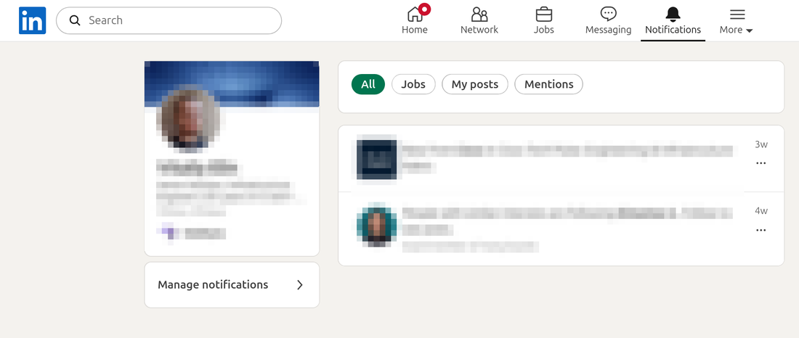
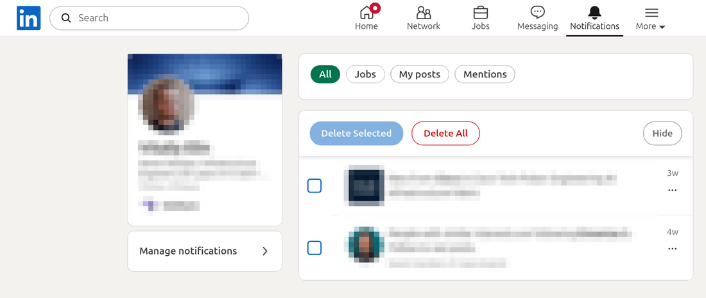

 

# LinkedIn Notifications Bulk Delete

Bulk delete notifications on LinkedIn.  
Adds checkboxes to select multiple notifications for removal.

### Screenshots
| Before | After |
| :--- | :--- |
|  |  |

### Features
* Adds selection checkboxes to the left of notifications.
* Delete selected or all visible notifications with a single button.
* The «Hide» / «Bulk delete» button hides and shows the panel and checkboxes; the choice is remembered.
* Works without page reload (uses LinkedIn internal logic).
