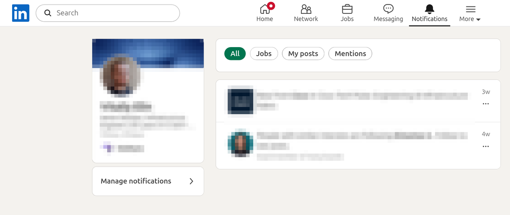
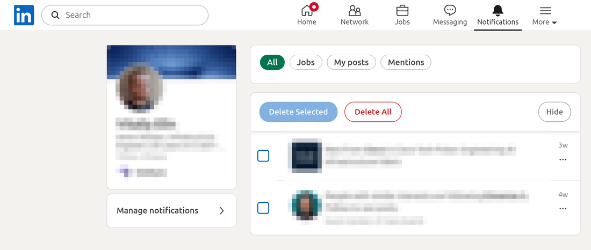

 

# LinkedIn Notifications Bulk Delete

Массовое удаление уведомлений в LinkedIn.  
Добавляет чекбоксы для выбора нескольких уведомлений и их удаления.

### Скриншоты
| До | После |
| :--- | :--- |
|  |  |

### Функционал
 Добавляет чекбоксы выбора слева от уведомлений.
 Удаление выбранных или всех видимых уведомлений одной кнопкой.
 Кнопка «Hide» / «Bulk delete» скрывает и показывает панель и чекбоксы, выбор запоминается.
 Работает без перезагрузки страницы (использует встроенную логику LinkedIn).
