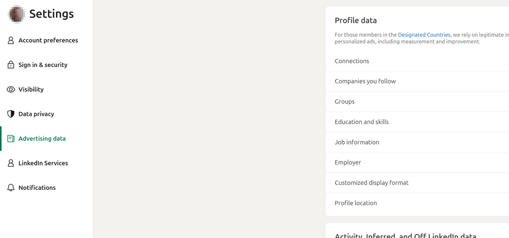
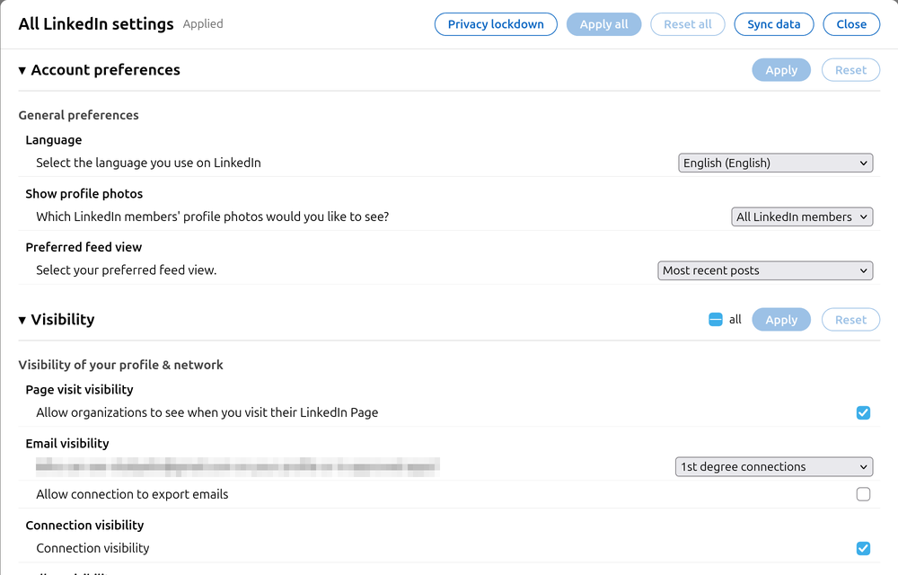

 

# LinkedIn Settings Overview

LinkedIn spreads its settings over six sections and about a hundred separate pages: to change one checkbox you go into a section, then into a sub-section, and there is no overview anywhere. That's especially true for what LinkedIn does with your data.  
This script puts all settings on one page, lets you change them in bulk and turns off sharing your data with advertisers, partners and AI training with one button.

### Screenshots
| Before | After |
| :--- | :--- |
|  |  |

### Features
* An "All settings" item in LinkedIn's [settings](https://www.linkedin.com/mypreferences/d/categories/account/) menu.
* Collapsible blocks in LinkedIn's order: Account preferences, Visibility, Data privacy, Advertising data, LinkedIn Services, Notifications; switches, choice lists and checkbox groups work as in LinkedIn itself. (Sign in & security has no settings, only passwords, addresses and sessions, so it isn't here.)
* Notifications as a table with In-app, Push and Email columns; the checkbox in a column header checks or unchecks the whole column.
* Every change is a draft at first: changes are highlighted, "Apply" sends them to LinkedIn with the same requests its own controls send, with a progress bar; "Reset" puts everything back. Each block has its own "Apply" and "Reset" besides the global ones, and an "all" checkbox for its switches.
* Including settings LinkedIn's menu doesn't lead to: ads by gender and age, by interests, location and activity, ad measurement and data sharing with partners; plus cookie consents.
* "Privacy lockdown" unchecks everything LinkedIn makes money on your data with: ad personalization (including by interests, gender, age and activity), advertising and analytics cookies, ads off LinkedIn and partner data, data for AI and research, marketing e-mails, profile visibility outside LinkedIn and in Microsoft apps, export of your data by company Pages and connections, data sharing with LinkedIn services.
* "Essentials only" for notifications checks only what matters: messages, InMail, interviews and messages from candidates, application updates, mentions, invitations, event reminders, billing (in-app and push); comments, followers, profile views, connection and candidate recommendations, job alerts, breaking news and activity on your Pages in-app only; email only for billing, interviews and applications. Feed recommendations, digests, games, tips, birthdays and the like are unchecked.
* On first use, "Build enhanced settings data" collects all settings: about 100 requests one at a time (LinkedIn answers fast requests with error 429), roughly 3 minutes. The result is saved, so the page opens instantly afterwards; "Sync data" collects it again.
* Works when you open the settings from within LinkedIn, without reloading the page.
