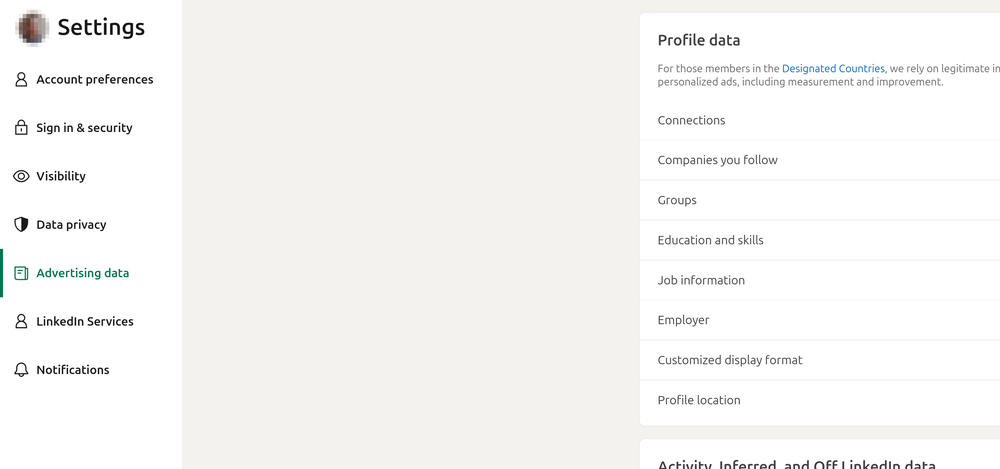
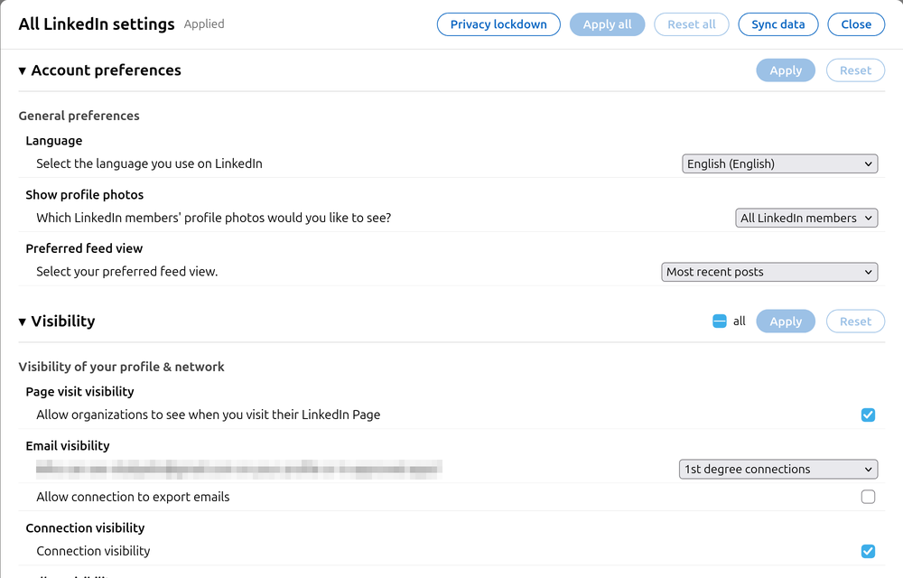

 

# LinkedIn: Все настройки на одной странице

Настройки LinkedIn разбросаны по шести разделам и сотне отдельных страниц: чтобы поменять одну галочку, надо провалиться в раздел, потом в подраздел, и общей картины нигде нет. Особенно это касается того, что LinkedIn делает с твоими данными.  
Скрипт собирает все настройки на одну страницу, позволяет менять их пачками и одной кнопкой отключает передачу данных рекламодателям, партнёрам и для обучения AI.

### Скриншоты
| До | После |
| :--- | :--- |
|  |  |

### Функционал
* Пункт «All settings» в меню [настроек](https://www.linkedin.com/mypreferences/d/categories/account/) LinkedIn.
* Сворачиваемые блоки в порядке LinkedIn: Account preferences, Visibility, Data privacy, Advertising data, LinkedIn Services, Notifications; переключатели, списки выбора и группы галочек — как в самом LinkedIn. (В Sign in & security нет настроек, только пароли, адреса и сессии, поэтому его здесь нет.)
* Уведомления — таблицей с колонками In-app, Push и Email; галочка в заголовке колонки отмечает или снимает всю колонку.
* Любое изменение сначала только черновик: изменённое подсвечивается, «Apply» отправляет изменения в LinkedIn теми же запросами, что и его собственные переключатели, с полосой прогресса; «Reset» возвращает как было. «Apply» и «Reset» есть у каждого блока и общие сверху; у каждого блока есть общая галочка «all» для его переключателей.
* Включая настройки, до которых из меню LinkedIn не добраться: рекламу по полу и возрасту, по интересам, местоположению и активности, измерение эффективности рекламы и передачу данных партнёрам; плюс согласия на куки.
* «Privacy lockdown» снимает всё, на чём LinkedIn зарабатывает на твоих данных: персонализацию рекламы (в том числе по интересам, полу, возрасту и активности), рекламные и аналитические куки, рекламу вне LinkedIn и данные партнёров, данные для AI и исследований, маркетинговые письма, видимость профиля вне LinkedIn и в приложениях Microsoft, экспорт твоих данных страницами компаний и контактами, передачу данных сервисам LinkedIn.
* «Essentials only» для уведомлений отмечает только то, что важно: сообщения, InMail, интервью и сообщения от кандидатов, статусы откликов, упоминания, приглашения, напоминания о событиях, счета (в приложении и push); комментарии, подписчиков, просмотры профиля, рекомендации контактов и кандидатов, job alerts, важные новости и активность своих страниц только в приложении; email только для счетов, интервью и откликов. Рекомендации ленты, дайджесты, игры, советы, дни рождения и т.п. выключаются.
* При первом открытии «Build enhanced settings data» собирает все настройки: около 100 запросов по одному (LinkedIn отвечает ошибкой 429 на быстрые запросы), примерно 3 минуты. Результат сохраняется, дальше страница открывается сразу; «Sync data» собирает его заново.
* Работает при переходе в настройки внутри LinkedIn, без перезагрузки страницы.
