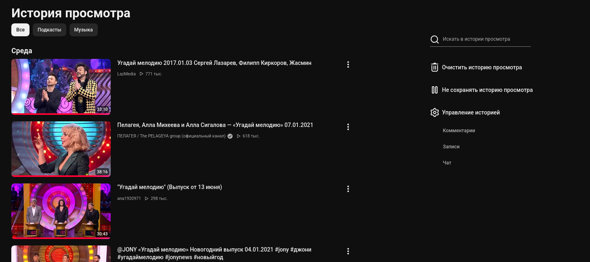
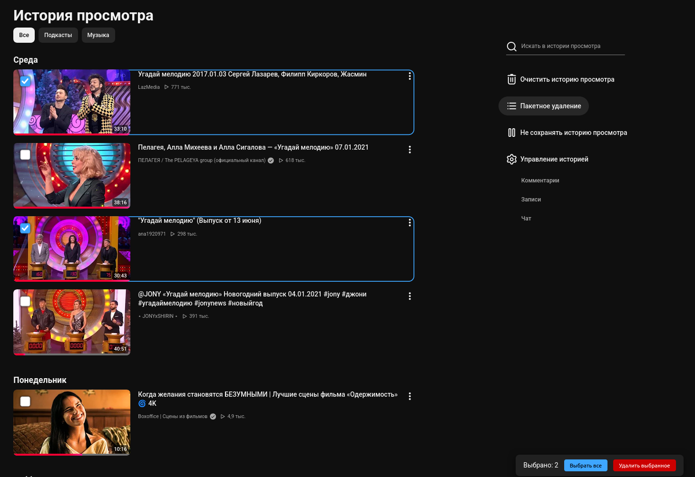

 

# YouTube History Bulk Delete

YouTube only lets you remove videos from your watch history one at a time, through each video's menu.  
This script adds checkboxes and removes the selected videos with one button.

### Screenshots
| Before | After |
| :--- | :--- |
|  |  |

### Features
* A "Bulk delete" button in your [watch history](https://www.youtube.com/feed/history), next to "Clear all watch history" and in the same style. It turns selection mode on and stays pressed while it is on; pressing it again turns it off.
* In selection mode: a checkbox in the corner of every video's thumbnail (nothing on the page moves); selected videos get an outline.
* Shift+click selects (or unselects) the range from the previous checkbox.
* A panel at the bottom right: selected count, "Select all" (all loaded videos), "Delete selected" with progress.
* Deletes with the same request as the "Remove from watch history" menu item, in batches, without opening any menus. A video for which that doesn't work is removed through its menu.
* Works when you open the history from within YouTube, without reloading the page.
